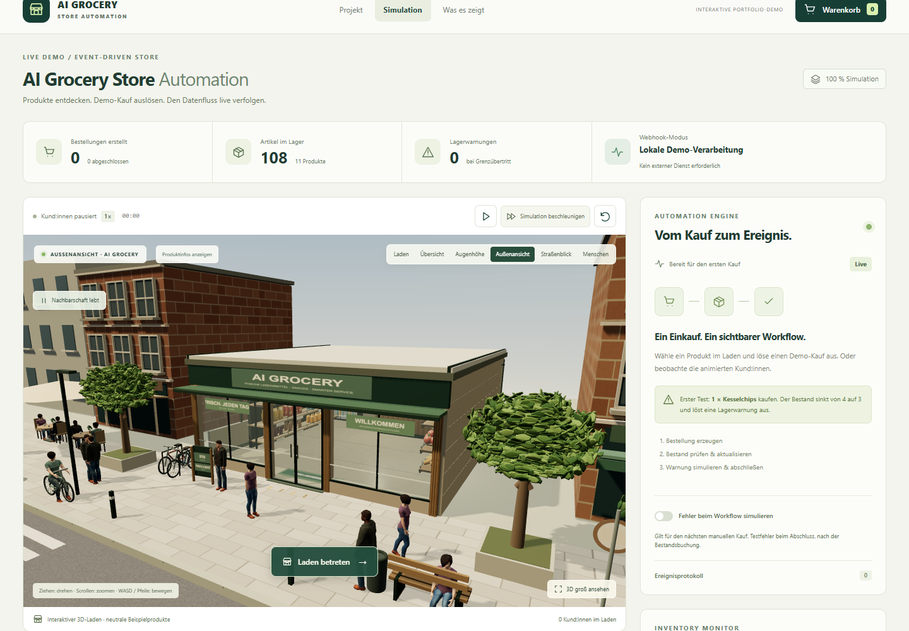
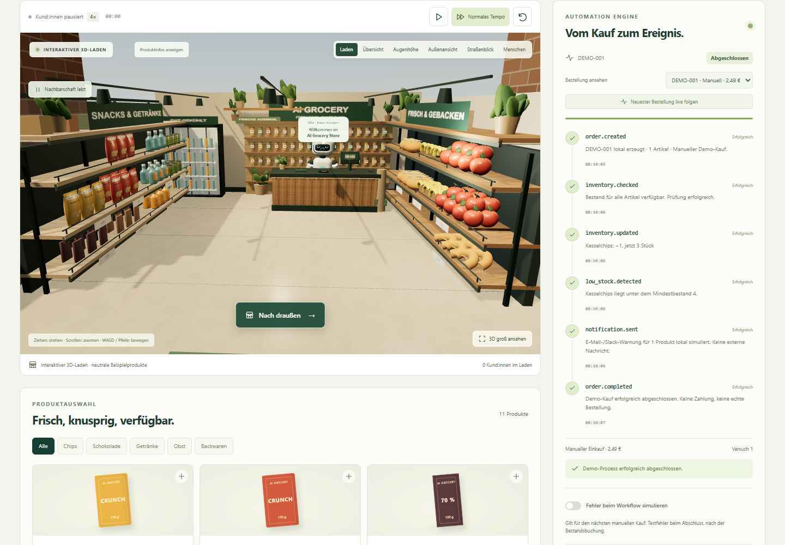
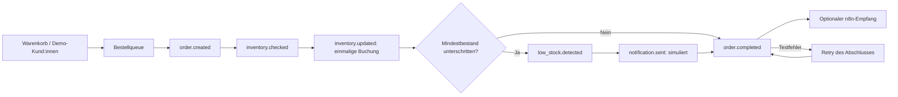

# Grocery Store · Webanwendung, Testing & Bestell-API

[](https://github.com/Nico89x/ai-grocery-store-automation/actions/workflows/verify.yml)
[](https://github.com/Nico89x/ai-grocery-store-automation/actions/workflows/pages.yml)

Ein interaktiver 3D-Laden macht einen Einkauf erlebbar; ein lokaler Ereignisprozessor macht Bestellung, Lagerbuchung, Warnung und Fehlerbehandlung sichtbar.

**Stack:** TypeScript · React · React Three Fiber · Node.js · SQLite · n8n-Webhooks · Vitest · Playwright

**For reviewers:** React / TypeScript / React Three Fiber portfolio simulation with an event-driven order queue, atomic inventory updates, observable workflows and safe completion retries. An optional, tested n8n webhook validates completed demo orders. No credentials needed for the default demo.

**[Live ausprobieren](https://nico89x.github.io/ai-grocery-store-automation/#/simulation)** · [Projektstudie](docs/CASE_STUDY.md) · [Demo-Video](https://nico89x.github.io/ai-grocery-store-automation/demo.mp4) · [Prüfnachweise](VERIFICATION.md) · [n8n-Anleitung](automation/README.md)




**Portfolio-Demo – keine echte Bestellung und keine Zahlung.** Keine Anmeldung, personenbezogenen Daten, echte Nachricht oder KI-API. Produkte und Personen sind Beispiele. Ohne Webhook-URL werden keine Bestellereignisse übertragen. Der Zustand liegt im Arbeitsspeicher und beginnt nach Neuladen von vorn.

## Zwei Betriebsmodi

| Modus                                     | Start                                                                             | Daten                                           |
| ----------------------------------------- | --------------------------------------------------------------------------------- | ----------------------------------------------- |
| Öffentliche 3D-Simulation                 | [Browserdemo](https://nico89x.github.io/ai-grocery-store-automation/#/simulation) | Browser-Arbeitsspeicher; Reset bei Neuladen.    |
| Lokale Bestell-API mit eigenem Web-Client | `node server/start.mjs`, dann http://127.0.0.1:4180                               | SQLite; Bestand und Belege überleben Neustarts. |

Die API prüft Preise und Mengen serverseitig und speichert wiederholbare Bestellungen in einer Transaktion. Sie verwendet denselben Produktkatalog, aber einen eigenen Bestand. Kein Login, keine Zahlung und kein öffentlicher Backend-Dienst. [Anleitung und API-Vertrag](server/README.md) · [Technische Arbeitsprobe](docs/ENGINEERING_CHANGE.md).

## In zwei Minuten ausprobieren

1. Die direkte Simulationsansicht startet mit pausierten Kund:innen, damit der erste Kauf reproduzierbar bleibt. Mit **Laden betreten** nach innen wechseln.
2. Eine gelbe Chips-Packung im 3D-Raum oder **Kesselchips Meersalz** in der Produktliste wählen. **In Warenkorb** → **Warenkorb ansehen** → **Demo-Kauf auslösen**.
3. Bestand **4 → 3**, Mindestbestand **4**: eine Lagerwarnung und sechs erfolgreiche Workflow-Schritte erscheinen.
4. **Fehler beim Workflow simulieren** einschalten und Mineralwasser kaufen. Nach dem Testfehler **Erneut versuchen** drücken: Wasser bleibt bei **14**, ohne zweite Bestandsbuchung.
5. **Kund:innen starten** und **Simulation beschleunigen** zeigen automatische Käufe über denselben Prozessor. **Simulation zurücksetzen** stellt den Ausgangszustand wieder her.

Ohne Grenzübertritt werden Warnung und Benachrichtigung übersprungen. Weitere Käufe eines schon niedrigen Bestands erzeugen keine zweite Warnung. Die Bestellauswahl zeigt auch ältere Abläufe der Sitzung.

## Lokal starten

Node.js **24 oder neuer** für Frontend und ergänzenden SQLite-Server. Für reproduzierbare Abhängigkeiten: **pnpm 11.25.0** und das enthaltene Lockfile.

```bash
npm install --global pnpm@11.25.0
pnpm install --frozen-lockfile
pnpm dev --port 4175 --strictPort
```

Die lokale Vorschau steht dann unter **http://127.0.0.1:4175/**. Sie ist nur auf dem Gerät erreichbar, auf dem der Server läuft. Der öffentliche Live-Link funktioniert unabhängig davon.

Alternativ funktionieren **npm install** und **npm run dev**. Die Browsertests setzen kein globales pnpm voraus; ihr Server startet direkt über Node.

```bash
pnpm test               # Logik-, Adapter-, Geometrie- und Assettests
pnpm test:backend       # SQLite-Persistenz und HTTP-Vertrag
pnpm test:e2e:backend   # Lokaler Bestell-Client im Browser
pnpm format:check       # Einheitliche Quellcodeformatierung
pnpm build              # TypeScript und Produktionsbuild
pnpm exec playwright install chromium
pnpm test:e2e           # 12 Browserfälle: Desktop und mobile Chromium-Ansicht
pnpm preview            # Produktionsbuild lokal öffnen
```

CI installiert mit festem Lockfile und prüft Formatierung, Tests, Build und Browserfälle. Die Browserfälle verwenden den zugänglichen Einstieg mit reduzierter Bewegung und prüfen das einschaltbare Straßenleben sowie animierte Kundenkäufe ausdrücklich. Die Demo-Aufnahme zeigt den normalen Bewegungseinstieg. CI verwendet den regulären Chromium-Headless-Shell-Browser. Die erste Wiederholung zeichnet eine vollständige Trace auf; fehlgeschlagene CI-Läufe speichern die verfügbaren Traces, Screenshots und Reports sieben Tage. Pages veröffentlicht erst nach erfolgreichen Prüfungen. Details und konkrete Ergebnisse: [VERIFICATION.md](VERIFICATION.md).

## Bedienung und 3D-Szene

- Ziehen dreht die Kamera; Scrollrad zoomt; rechte Maustaste verschiebt. WASD / Pfeile bewegen die Ansicht, wenn kein Dialog oder Eingabefeld fokussiert ist.
- Sechs Ansichten: **Laden**, **Übersicht**, **Augenhöhe**, **Außenansicht**, **Straßenblick**, **Menschen**. **Andere Person ansehen** wechselt sechs Erscheinungsprofile auf Basis dreier Modelle.
- Touch: ein Finger dreht, zwei Finger zoomen und verschieben; zusätzliche Pfeiltasten bewegen die Kamera.
- **3D groß ansehen** vergrößert die Szene. **Straßenleben pausieren** stoppt Nachbarschaftsanimationen unabhängig von den Demo-Kund:innen.
- Kund:innen wählen Produkte und erzeugen Bestellungen. Café-Gäste, Passant:innen, Fahrzeuge und Radfahrer beleben die Umgebung und buchen keine Waren.
- Produktliste und Dialoge bieten dieselben Funktionen ohne 3D-Klick. Dialoge besitzen Fokusbindung und Escape-Bedienung. Bei fehlendem WebGL bleibt der Einkauf über HTML nutzbar.

Laden, Roboter, neutrale Verpackungen und Umgebung entstehen aus Projektcode. Die Menschen verwenden lokal gebündelte **CC0-MakeHuman-Assets**, eigene Anpassungen und prozedurale Animationen. Alle Charakterdateien zusammen liegen unter 6 MB. [Herkunft und Lizenz](THIRD_PARTY_ASSETS.md). Keine externen Asset-CDNs; keine Motion-Capture- oder fotorealistischen Scans.

## Architektur und Datenfluss



| Bereich                               | Verantwortung                                                             |
| ------------------------------------- | ------------------------------------------------------------------------- |
| src/domain/products.ts                | 11 neutrale Produkte, Cent-Preise, Start- und Mindestbestand              |
| src/domain/simulation.ts              | Reiner Reducer: Warenkorb, Queue, Kundenphasen, Events, Lager und Retry   |
| src/hooks/useSimulation.ts            | Zeittakt, Reset und einmalige Webhook-Zustellung je Sitzung               |
| src/scene/                            | Laden, Kamera, Produkte, Roboter, Charaktere und Nachbarschaft            |
| src/components/                       | Zugängliche Dialoge, Workflow-Panel, Produktabbildungen und Projektstudie |
| src/services/webhook.ts               | Einziger externer Erweiterungspunkt und Empfangsprüfung                   |
| automation/                           | Importierbarer n8n-Workflow, Beispielereignis und Anschlussanleitung      |
| e2e/ und scripts/human-assets.test.ts | Bedienabläufe und gültige lokale Charakterdateien                         |

Hash-Routen **#/** und **#/simulation** funktionieren auf GitHub Pages ohne Serverrouting. Die 3D-Szene wird getrennt geladen. Prozedurale Materialien entstehen einmal pro Szene; Charaktere teilen Geometrien/Texturen und besitzen getrennte Skelette.

**Konsistenz:** Preise sind ganze Cent-Werte. Bestellungen speichern Preis-/Mengen-Snapshots. Die Queue prüft unmittelbar vor der Buchung alle Artikel gemeinsam; keine Teilbuchung, kein negativer Bestand. Das Merkmal **inventoryApplied** verhindert einen zweiten Abzug beim Retry. Eine Warnung entsteht nur beim Grenzübertritt. Reset beendet laufende externe Requests. Kundenkäufe und Warenkorb verwenden denselben Prozessor.

## Was n8n übernimmt

Die Lagerbuchung und das sichtbare Workflow-Panel laufen **lokal**. Erst nach erfolgreichem Abschluss sendet **deliverOrder()** optional **order.completed** an n8n. Der Testworkflow prüft Demo-Kennzeichnung, Artikel, Mengen, Beispielpreise und Summe. Er erzeugt simulierte Warnungsdatensätze und antwortet mit einer echten Ausführungs-ID.

**Webhook verbunden** erscheint erst, wenn der Empfangsbeleg zu Bestell-ID, Ereignisschlüssel und Summe passt. HTTP 200 allein genügt nicht. Ohne URL erfolgt kein Request; bei Timeout oder ungültiger Antwort bleibt der abgeschlossene lokale Kauf erhalten.

Unter **Lager im Blick → n8n-Testverbindung konfigurieren** eine URL für den nächsten Kauf aktivieren. Alternativ:

```dotenv
VITE_AUTOMATION_WEBHOOK_URL=https://dein-n8n.example/webhook/ai-grocery-portfolio-demo
```

Eine **.env.local** ist nicht eingecheckt; nach Änderung neu starten/builden. VITE-Werte sind öffentlich: keine Geheimnisse eintragen. Die öffentliche Demo startet bewusst ohne Endpunkt. Die lokale geprüfte Instanz lässt sich nicht automatisch an andere Besucher weitergeben. [Import, CORS, aktueller Empfangsnachweis und Grenzen](automation/README.md).

## Umfang, Rolle und Erweiterungen

Nico89x definiert Konzept, Anforderungen und Zielbild. Implementierung, eigene Szenengeometrie, Animationen, Dokumentation und technische Prüfungen entstanden mit KI-Unterstützung. Eingebundene Charakterdaten sind separat dokumentiert. [Projektstudie](docs/CASE_STUDY.md) und [Gesprächsleitfaden](docs/INTERVIEW_GUIDE.md) erklären die Entscheidungen ohne erfundene Geschäftsergebnisse.

Die Demo zeigt Zustandsverarbeitung und einen geprüften n8n-Anschluss. Sie enthält keinen produktiven Shop, kein dauerhaftes Warenwirtschaftssystem und keine echte KI. NOA antwortet aus lokalen Daten. Bestände werden nicht dauerhaft gespeichert; der n8n-Testempfänger führt keine dauerhafte Deduplizierung durch. Physische Mobilgeräte wurden bislang nicht vermessen; mobile Chromium-Prüfungen ersetzen keinen Gerätetest.

Die Grafikqualität lässt sich in der Szene umschalten. Automatisch nutzt die App auf kleinen Bildschirmen und bei erkennbarer Software-Grafik eine Pixeldichte von 1 ohne dynamische Schatten; auf Desktop-Grafikkarten bleiben detaillierte Schatten und höhere Auflösung erhalten. Produkte, Menschen, Animationen und Fachlogik sind in beiden Modi verfügbar. Diese Erkennung ist eine einfache Heuristik, kein gemessener FPS-Regler.

Das ergänzende lokale Backend mit SQLite und serverseitiger Idempotenz steht in [server/](server/). Es wird separat gestartet. Mögliche nächste Schritte sind eine bewusst gestaltete Kopplung beider Betriebsmodi, Nachbestellung/Wareneingang und exportierbare Reports.

**Lizenz:** Projektcode unter [MIT](LICENSE); eingebundene Charakterdaten unter [CC0](THIRD_PARTY_ASSETS.md). Abhängigkeiten behalten ihre jeweiligen Lizenzen.
